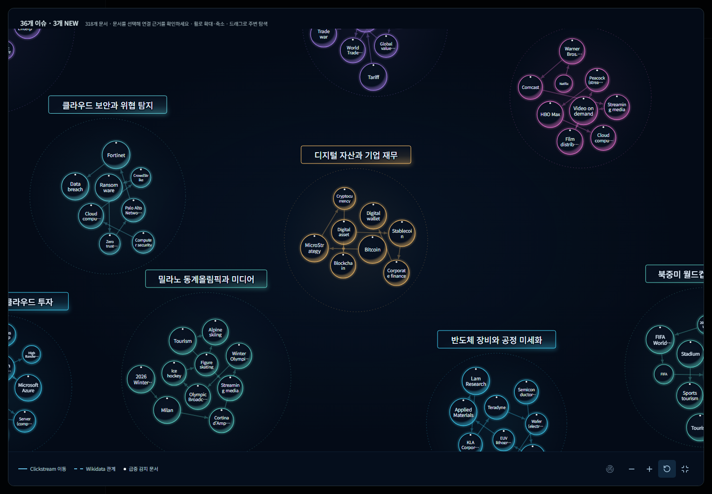

# WikiPulse

**위키피디아 편집 급증에서 실시간 이슈를 포착하고, 관련 미국 상장 종목을 근거와 함께 연결하는 이슈 피드 서비스**

<p align="center">
  
</p>

사람이 직접 편집한 위키피디아 문서 가운데 조회수까지 함께 급등한 문서를 찾아 이슈 단위로 묶습니다.
각 이슈에는 GDELT 뉴스 동시 출현과 벡터 유사도로 후보 종목을 고르고, LLM이 "왜 관련 있는가"를 근거 경로로 검증한 종목만 붙입니다.

> 종목 연결은 자동 매핑 결과이며 투자 권유가 아닙니다. 연결 강도는 사업 구조의 직접성을 나타낼 뿐 주가 방향이나 수익률을 뜻하지 않습니다.

## 주요 기능

- **이슈 감지·클러스터링**: 봇이 아닌 편집이 1건 이상 있는 문서만 조회수 급등을 검사하고, 두 관문을 모두 통과한 문서를 Clickstream·Wikidata 관계로 묶습니다.
- **펄스맵**: 클러스터를 버블로, 급등도를 크기로 보여 주며 시간 슬라이더로 과거 시점을 재생합니다.
- **이슈 피드와 상세**: 카드/리스트 피드, 이슈별 대표 문서·타임라인·요약 리포트를 제공합니다.
- **이슈별 관련 종목**: 임베딩 Top-K 후보 → GDELT 근거 → LLM 검증을 거친 종목만 노출합니다.
- **종목 상세**: 주가 그래프 위에 이슈 발생 시점을 표시하고, 그 종목이 걸린 이슈를 모아 보여 줍니다.

## 아키텍처

```
 [수집]                    [저장·큐]              [연산]                    [서빙]

 Wikipedia EventStreams ─▶ Kafka ───────────────▶ Spark Structured ──┐
   (SSE, 편집 이벤트)        (토픽: wiki.edits)      Streaming          │
                                                    편집 발생 1차 관문     │
 other/pageviews 시간별 ──▶ HDFS·배치 적재       ─▶ 조회수 2차 관문     ├─▶ PostgreSQL ─▶ Spring Boot ─▶ React
                                                                        │   + pgvector      REST API      펄스맵·피드·
 Clickstream (월) ─────────▶ (관계 가중치)                                │                                 종목 상세
                                                                        │
 GDELT GKG (15분 파일)  ──▶ HDFS (2노드) ────────▶ Spark 배치           │
                                                    종목 근거 추출       │
                                                                        │
 과거 원본 (리플레이) ───▶ HDFS ─────────────────▶ Spark 배치           │
                                                    과거 시점 스냅샷     │
                                                                        │
 SEC/NASDAQ 종목 마스터 ──▶ PostgreSQL ──────────▶ 종목 임베딩         ─┘
                                                            │
                                                     LLM 검증
                                                     이슈 ↔ 후보 종목 근거 판정
```

데이터 서버와 서비스 서버 두 대가 각각 HDFS DataNode와 Spark Worker를 맡습니다. Kafka·Spark Master·NameNode는 데이터 서버에, Nginx·Spring Boot·PostgreSQL은 서비스 서버에 둡니다.

## 기술 스택

| 영역 | 기술 |
| --- | --- |
| 데이터 처리 | Apache Kafka, Spark 3.5 (Structured Streaming·배치), HDFS, Python 3.11 |
| 백엔드 | Java 17, Spring Boot 3.5, Spring Security·Session, JPA |
| 저장 | PostgreSQL 17 + pgvector |
| 프론트엔드 | React 19, Vite, Playwright |
| AI | OpenAI 임베딩, Claude 기반 근거 검증·요약 |
| 인프라 | Docker Compose, Nginx, GitLab CI |

## 저장소 구성

| 폴더 | 내용 |
| --- | --- |
| [`data-pipeline/`](data-pipeline) | 수집(EventStreams→Kafka), Spark 스트리밍·배치, 클러스터링, GDELT·종목 적재 |
| [`backend/`](backend) | Spring Boot REST API, 후보 생성·LLM 검증 워커, 계정·북마크 |
| [`frontend/`](frontend) | 펄스맵·이슈 피드·이슈 상세·종목 상세 UI |
| [`db/`](db) | PostgreSQL 마이그레이션과 스키마 테스트 |
| [`ai/`](ai) | 매칭·이슈 텍스트·LLM 검증 실험과 근거 스크립트 |
| [`infra/`](infra), [`docker/`](docker) | 서버별 Compose 구성, Spark·HDFS·Nginx 설정 |
| [`tools/`](tools) | 벤치마크, 리포트 생성, 스모크 테스트 |
| [`docs/`](docs) | 요구사항·기술 명세, API·ERD, 검증 기록 |

## 문서

- [요구사항 명세](docs/requirements-v0.3.md) · [기술 명세](docs/tech-spec-v0.3.md) · [API](docs/api-v0.3.md) · [ERD](docs/erd-v0.1.md)
- [검증 기록 목록](docs/validation/INDEX.md)

## 로컬 실행

```bash
cp .env.example .env        # 값을 채운다
docker compose up -d        # PostgreSQL · 백엔드 · 프론트엔드
```

파이프라인과 서버별 구성은 [`docker/README.md`](docker/README.md)와 [`infra/README.md`](infra/README.md)를 참고하세요.

## Team

| 역할 | GitHub |
| --- | --- |
| PM · AI | [@ClOhmYee](https://github.com/ClOhmYee) |
| 백엔드 · Issue/Stock API, 데이터 모델링 | [@bjs0306b](https://github.com/bjs0306b) |
| 백엔드 · Wikipedia 수집, 실시간 Issue API | [@sangeune](https://github.com/sangeune) |
| 백엔드 · 뉴스·기업 데이터 연동, AI 파이프라인 API | [@lavendmin](https://github.com/lavendmin) |
| 프론트엔드 · 펄스맵, 이슈 상세 | [@yl65698](https://github.com/yl65698) |
| 인프라 · Kafka/Spark/HDFS, 배포 | [@LYJ22](https://github.com/LYJ22) |
